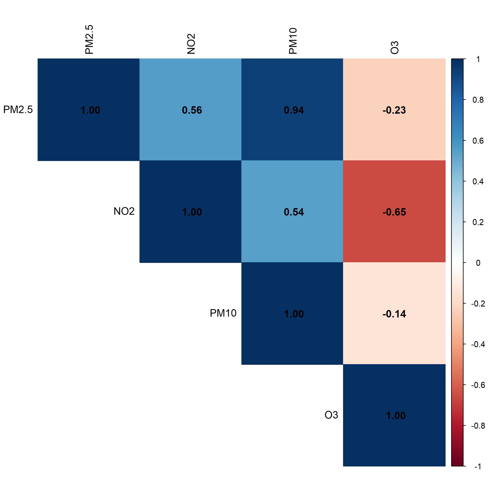

# UK Air Quality Analysis During and After COVID-19 Pandemic
###### This project is for academic/educational purposes. Data is sourced from UK-AIR (DEFRA) and subject to their terms of use.
###### All rights reserved © Iulia Sapungiu

## Table of contents
 - [Project Overview](#project-overview)
 - [Glossary: the pollutants](#glossary-the-pollutants)
 - [Research Questions](#research-questions)
 - [Key Findings](#key-findings)
 - [Technologies](#technologies)
 - [Installation and usage](#installation-and-usage)
 - [Project Structure](#project-structure)


### Project Overview
This project analyses how air pollutant concentrations (PM₂.₅, PM₁₀, NO₂, and O₃) varied across four major UK cities (Edinburgh, London, Manchester, Sheffield) during the pandemic period (2020-2021) and post-pandemic recovery (2022-2024). 
The analysis uses data from UK Data Selector - Air urban background monitoring stations to examine temporal and spatial patterns, and develops predictive models to understand relationships between pollutants.

**MOTIVATION**

COVID-19 lockdowns sharply reduced traffic and activity, giving a rare chance to see how urban air quality responded. This project compares pollutant levels during the pandemic (2020-21) and the recovery (2022-24) in four UK cities, and tests whether NO₂, a traffic-related pollutant, can help estimate PM₂.₅.

### Glossary: the pollutants

| Pollutant | What it is | Main sources | Why it matters |
|---|---|---|---|
| **PM₂.₅** | Particulate matter: tiny airborne particles up to 2.5 micrometres across (about 30 times thinner than a human hair) | Vehicle exhaust, burning of fuels and wood, industry; also forms from other pollutants in the air | Small enough to reach deep into the lungs and bloodstream, so it is among the most harmful pollutants to health |
| **PM₁₀** | Larger airborne particles up to 10 micrometres across (this size range includes PM₂.₅) | Road and construction dust, brake and tyre wear, vehicle exhaust | Can irritate the eyes, nose, throat and lungs |
| **NO₂** | Nitrogen dioxide, a gas | Mainly burning fuel in vehicle engines (especially diesel), and also heating and power generation | Can inflame the airways; widely used as an indicator of traffic pollution |
| **O₃** | Ozone. At ground level it is a pollutant (not the protective ozone layer high in the atmosphere) | Not emitted directly: it forms when sunlight reacts with other pollutants such as nitrogen oxides | Can cause breathing problems; tends to be higher in sunny weather |

Concentrations are typically measured in micrograms per cubic metre (µg/m³).

### Research Questions
- RQ1 (Exploratory Data Analysis)
How did daily concentrations of PM₂.₅, PM₁₀, NO₂, and O₃ vary across major UK cities during and after the COVID-19 pandemic period (2020-2024)?
- RQ2 (Simple Linear Regression)
How well does NO₂ alone explain variation in daily PM₂.₅ concentrations across the selected UK cities, stratified by city and period?
- RQ3 (Multiple Linear Regression)
Do additional pollutants (PM₁₀ and O₃) improve prediction of PM₂.₅ beyond NO₂ alone, stratified by city and period?

### Key Findings
**RQ1:** Improvements were mixed and short-lived. NO₂ fell during early lockdown, especially in London, but rebounded afterwards, while Manchester showed almost no change. PM₂.₅ and PM₁₀ varied inconsistently, with no lasting reduction. O₃ increased in the post-pandemic period, mostly in Manchester and Sheffield, likely driven by atmospheric chemistry, while Edinburgh had generally higher O₃ levels throughout.


###### All other plots are in the plots/ folder.

**RQ2:** NO₂ explains PM₂.₅ variation in traffic-dominated cities (London, Manchester, Sheffield) but performs poorly in Edinburgh, where PM₂.₅ is more influenced by regional transport and non-traffic sources. The relationship was strongest in the post-pandemic period.

**RQ3:** Yes. Models using all pollutants explained PM₂.₅ better than NO₂ alone in both periods, suggesting urban PM₂.₅ comes from diverse emissions and atmospheric effects.

#### Takeaway

Lockdown-era air quality gains were not sustained, and PM₂.₅ is best estimated from several pollutants rather than from NO₂ alone.

### Technologies
- R version 4.0.0 or higher
- tidyverse - Data Manipulation and visualisation
- lubridate - Date handling
- ggplot2 - Plotting
- patchwork - combining plots
- corrplot - Correlation matrix visualisation

### Installation and usage
#### Step 1: Setup
1. Clone or download this repository _(make sure to delete plots and processed_data folders so that you create them when running the code)_
2. Place your data file ```uk_air_quality_data.csv``` in the project root directory
3. Open R or RStudio and set your working directory to the project folder ```air_quality_analysis```
4. Install required packages (if not already installed) and load them one by one:

   ```
    install.packages(c("tidyverse", "lubridate", "ggplot2", "patchwork", "corrplot"))
   
    library(tidyverse)    
    library(lubridate)    
    library(ggplot2)      
    library(patchwork)
    library(corrplot)
   ```

5. Configuration option (Saving behaviour - code line 27)

   ```
    save_plots_to_file <- TRUE  # Set to FALSE to display plots in RStudio only
   ```
   - TRUE: Plots are saved to plots/ folder (faster, recommended)
   - FALSE: Plots are displayed in RStudio viewer (slower, for interactive viewing)
  
   Also, a Random Seed ```set.seed(123)``` is used in the analysis for:
    - Consistent train/test splits
    - Reproducible results across runs

#### Step 2: Run EDA by step-level documentation block (Research Question 1)

   ```
    source("01_EDA_analysis.R")
   ```
  What this does:
  - Loads and cleans raw data
  - Generates daily time-series plots (4 pollutants × 4 cities)
  - Creates monthly trend visualizations
  - Performs pandemic vs. post-pandemic statistical comparisons (t-tests)
  - Analyzes pollutant relationships (correlations and scatterplots)
  - Saves processed datasets to processed_data/ folder
  - Saves all plots to plots/ folder

#### Step 3: Run Regression Models by step-level documentation block (Research Questions 2 & 3)
After completing Step 2, run the regression analysis:

   ```
    source("02_regression_models.R")
   ```

What this does:
- Loads processed data from Step 2
- Splits data into training (80%) and test (20%) sets
- Fits separate regression models for each City × Period combination:
  - RQ2: PM₂.₅ ~ NO₂ (simple regression, 8 models)
  - RQ3: PM₂.₅ ~ NO₂ + PM₁₀ + O₃ (multiple regression, 8 models)
- Evaluates models on independent test sets
- Checks for multicollinearity (VIF)
- Compares RQ2 vs. RQ3 performance
- Saves all results and visualizations

### Project Structure

```
UK-Air-Quality-Analysis/
│
├── README.md                          # This file
├── uk_air_quality_data.csv           # Raw dataset from UK-AIR (not included - add your own)
│
├── scripts/
│   ├── 01_EDA_analysis.R             # Exploratory Data Analysis (RQ1)
│   └── 02_regression_models.R        # Regression modeling (RQ2 & RQ3)
│
├── processed_data/                    # Generated by 01_EDA_analysis.R
│   ├── air_quality_clean_long.csv    # Clean data in long format
│   ├── air_quality_clean_wide.csv    # Clean data in wide format
│   ├── air_quality_monthly.csv       # Monthly aggregated data
│   ├── period_summary.csv            # Descriptive stats by period
│   ├── test_results.csv              # T-test results (pandemic vs post)
│   ├── correlation_matrix.csv        # Correlation matrix (training data)
│   ├── RQ2_city_period_summary.csv   # RQ2 regression results
│   ├── RQ3_city_period_summary.csv   # RQ3 regression results
│   └── RQ2_vs_RQ3_comparison.csv     # Model comparison results
│
└── plots/                             # Generated visualizations
    ├── daily_timeseries_*.png        # Daily time-series plots (4 pollutants)
    ├── monthly_trend_*.png           # Monthly aggregated trends (4 pollutants)
    ├── boxplot_comparison_*.png      # Period comparison boxplots (4 pollutants)
    ├── scatterplot_*.png             # Pollutant relationship plots
    ├── correlation_matrix.png        # Correlation heatmap
    ├── RQ2_*.png                     # RQ2 visualizations
    ├── RQ3_*.png                     # RQ3 visualizations
    └── RQ2_vs_RQ3_*.png              # Model comparison plots

```
